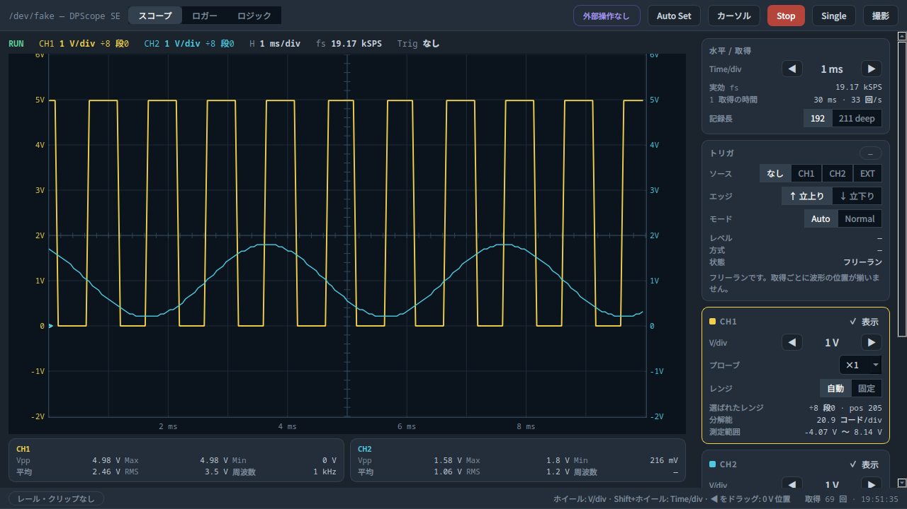
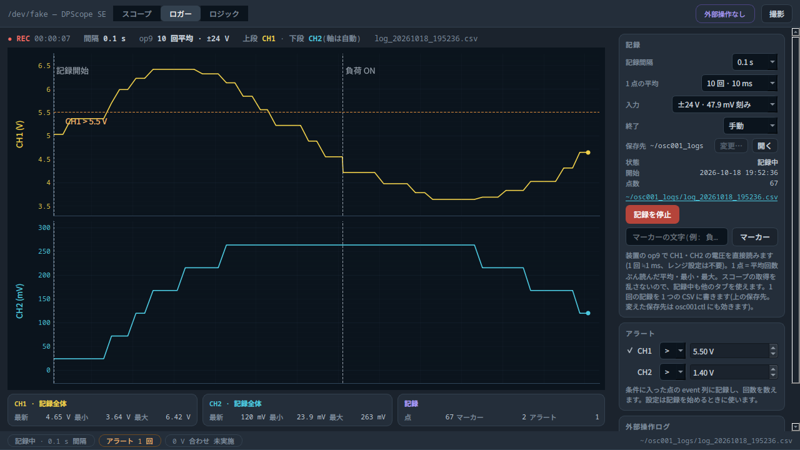
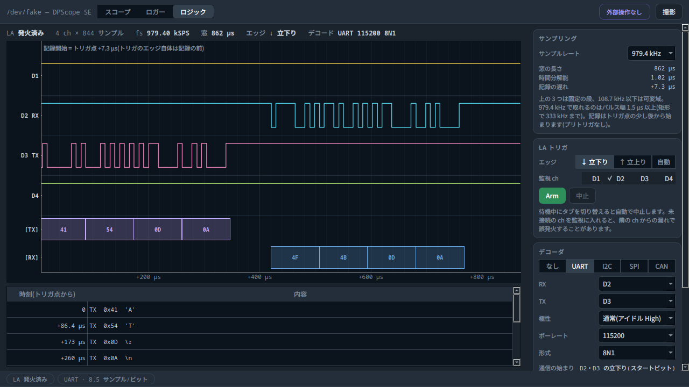

# osc001_viewer

USB オシロスコープ基板 osc001 を Linux で使うための画面と、外部(LLM・スクリプト)からの操作口です。
スコープ・ロガー・ロジックアナライザ(UART・I2C・SPI・CAN のデコーダ付き)の 3 画面があり、
同じ操作を bash のコマンド `osc001ctl` と Python のクライアントからも行えます。
装置の操作には [osc001_api](https://github.com/nomumu/osc001_api)(submodule)を使います。

> **非公式のソフトウェアです。** osc001 は秋月電子通商が販売していた USB オシロスコープ基板
> 「OSC001 PCB SCOPE」で、装置は USB 上で「DPScope SE」と名乗ります。本ソフトウェアは、
> 販売元・製造元・DPScope の設計者のいずれとも関係がなく、承認や支援も受けていません。
> 製品名・商標はそれぞれの所有者に帰属します。

| スコープ | ロガー | ロジック |
| --- | --- | --- |
|  |  |  |

(画像は装置なしで動かす `--fake` の画面です)

## できること

**スコープ**
- 2ch、1 ms/div〜50 s/div(最大 33 kSPS/ch)、入力 ±24 V
- V/div を選ぶと、画面の範囲を覆う最も細かい装置のレンジを自動で選ぶ(固定もできる)。プローブ倍率に対応
- トリガ: CH1・EXT はハードウェア、CH2 はソフトウェア(取得した波形から探す)。Auto / Normal / Single
- Vpp・最大・最小・平均・RMS・周波数、カーソル、Auto Set、0 V 合わせ
- 遅い時間軸では取得の途中から左へ描いていく(フリーランのとき)
- 画面の保存(Ctrl+Shift+S、波形の CSV も一緒に保存できる)

**ロガー**
- CH1・CH2 の直流電圧を 0.1 秒〜の間隔で記録する。装置のモニタ経路(op9)で ±24 V を直接読むので、
  レンジの設定が要らず、記録中もスコープやロジックの画面を使える
- 1 点ごとに平均・最小・最大。アラート(しきい値)とマーカー(注記)を記録に残す
- 1 回の記録 = 1 つの CSV(下の「ログの形式」)

**ロジック**
- 4ch × 844 サンプル、979.4 kHz〜10 Hz。立上り・立下りのトリガ
- デコーダ: UART(TX・RX、8N1 / 8E1 / 8O1、反転)、I2C、SPI(モード 0〜3)、CAN(標準・拡張 ID、CRC 検査)
- 1 ビットあたりのサンプル数を確かめ、足りなければ注意とレートの提案を出す。UART はパルス幅から
  実際のボーレートを測って読む(送り手が数 % ずれていても読める)

**外部からの操作**
- `osc001ctl`(bash)と Python のクライアントが、同じ操作を同じ JSON で返す
- GUI が起動していれば GUI に、なければ画面のない常駐プロセス `osc001d` に頼む
- 全操作のツール定義(JSON Schema)を出せるので、ローカル LLM の関数呼び出しに登録できる

## 動作環境

- Linux(Ubuntu 24.04 で確認)、Python 3.12 以上
- 画面: 1280 × 720 以上、マウス
- GUI: PySide6(Qt 6)・pyqtgraph。Qt 6.5 以降を X11 で使うには `libxcb-cursor0` が要ります
- 外部操作(`osc001ctl`・`osc001d`・Python クライアント)は numpy だけで動き、GUI のライブラリは要りません

## インストール

```bash
sudo apt install pipx libxcb-cursor0      # libxcb-cursor0 は GUI を使う場合
git clone --recursive https://github.com/nomumu/osc001_viewer.git
pipx install "./osc001_viewer[gui]"       # 外部操作だけなら "./osc001_viewer"
```

`osc001-viewer`・`osc001ctl`・`osc001d` の 3 つのコマンドが `~/.local/bin/` に入り、どこからでも使えます
(初めて pipx を使う場合は `pipx ensurepath` を実行して、端末を開き直してください)。
`--recursive` を付けずに clone した場合は、`git submodule update --init` を実行してから入れてください。
アンインストールは `pipx uninstall osc001-viewer` です。

pipx を使わずに venv に入れることもできます。その場合は venv を有効にしてから使います。

```bash
cd osc001_viewer
python3 -m venv .venv
.venv/bin/pip install ".[gui]"
source .venv/bin/activate                 # 以後 osc001-viewer などがそのまま使える
```

### 装置の権限(udev)

一般ユーザーで `/dev/hidraw*` を開けるように、udev ルールを置きます(`/etc/udev/rules.d/70-osc001.rules`)。

```
SUBSYSTEM=="hidraw", ATTRS{idVendor}=="04d8", ATTRS{idProduct}=="f891", TAG+="uaccess"
```

```bash
sudo udevadm control --reload-rules && sudo udevadm trigger
```

画面のない機械で使う場合のルールは [osc001_api の README](https://github.com/nomumu/osc001_api#セットアップlinux--raspberry-pi) を見てください。

## 使い方

```bash
osc001-viewer             # 装置を自動で探して起動
osc001-viewer --fake      # 装置なしで偽の信号を表示する(画面の確認用)
```

`python -m osc001_viewer` でも同じように起動します。

- 起動したら、まず入力を GND につないで **0 V 合わせ**をしてください(スコープ画面の右側の「0 V 合わせ…」)。
  基板の可変抵抗で ch ごとの 0 V がずれるためです。結果は保存され、次回から使われます。
- 波形の上でホイールを回すと V/div、Shift+ホイールで Time/div、左端の ◀ をドラッグで 0 V の位置が変わります。
- `--readonly` で外部からの設定変更を止めた状態で、`--no-server` で外部操作の口を開けずに起動します。

### ロジックアナライザの注意

- 記録はトリガ点の少し後から始まります(979.4 kHz で 7.3 µs、490.9 kHz で 6.8 µs、200 kHz で 6.3 µs、
  108.7 kHz 以下で約 1.8 サンプル。プリトリガなし)。デコーダは、トリガのエッジを通信の始まり
  (スタートビット・START・SOF)として補います。
- 979.4 kHz で取れるのはパルス幅 1.5 µs 以上です。目安として UART は 115200 bps(230400 bps はぎりぎり)、
  I2C は 100 kHz、SPI は 250 kHz、CAN は 250 kbps までです。
- アイドルの無い UART の連続送信の途中でトリガすると、バイトの区切りが一意に決まらないことがあります
  (その場合は注意を出します)。通信の始まりの前にアイドルがある所でトリガしてください。

## 外部からの操作(LLM・スクリプト)

### bash から

```bash
osc001ctl status
osc001ctl read-voltage --avg 10                      # 直流電圧をすぐ読む(±24 V、約 1 ms/回)
osc001ctl set-channel 1 --vdiv 1 --pos-div -2
osc001ctl set-trigger ch1 --edge rising --level 2.5 --mode auto
osc001ctl capture                                    # 1 回取得して統計値を返す
osc001ctl --csv capture > wave.csv                   # t,ch1,ch2(秒・V)
osc001ctl log-start --interval 1 --avg 10 --duration 2h --alerts '["ch1<3.6"]'
osc001ctl marker "負荷 ON"
osc001ctl --csv log-get --last 10m --max-points 200
osc001ctl log-stop
osc001ctl la-capture --rate 979400 --channels 2 --edge falling \
    --decode '{"protocol": "uart", "rx": 2, "baud": 115200}'
osc001ctl --help                                     # 全コマンド。各コマンドも --help で説明を出す
```

出力は既定で JSON 1 個です(`jq` で扱えます)。`--out FILE` を付けると結果をファイルに書き、
パスと要約だけを返します(LLM の文脈を電圧の列で埋めないため)。
エラーは `{"error": {"code", "message", "hint"}}` で、`hint` に直し方を書きます。

| 終了コード | 意味 |
| --- | --- |
| 0 | 成功 |
| 1 | 想定外のエラー |
| 2 | 装置のエラー(未接続・トリガ待ちの時間切れなど) |
| 3 | 外部からの設定変更が止められている(`--readonly`) |
| 4 | 引数の誤り |
| 5 | サーバ(GUI・osc001d)が無い |

GUI を起動していないときは `osc001ctl daemon start` で `osc001d` を起動し、`osc001ctl daemon stop` で止めます。
装置を開けるのは 1 つのプロセスだけなので、`osc001d` が動いている間は GUI を起動できません。

### Python から

```python
from osc001_viewer.client import Client

with Client() as c:                     # GUI か osc001d につなぐ
    v = c.read_voltage(avg=10)          # {"ch1": ..., "ch2": ..., ...}
    c.set_trigger(source="ch1", edge="rising", level=2.5)
    w = c.capture(samples=True)         # 統計値と、時刻・電圧の列
    c.marker(text="測定開始")
```

メソッド名は `osc001ctl` のコマンド名の snake_case(`log-start` → `log_start`)で、返り値は同じ JSON(dict)です。
失敗すると `ClientError`(`code`・`message`・`hint`)を送出します。

### LLM のツールとして使う

```bash
osc001ctl schema --format openai        # 関数呼び出しの形式(Ollama・llama.cpp・LM Studio など)
osc001ctl schema --format mcp           # MCP のツール定義の形式
osc001ctl call capture '{"samples": false}'    # 操作名と JSON の引数で呼ぶ
```

`schema` が全操作の説明と引数を出すので、LLM の側ではそれを登録し、呼び出しを `osc001ctl call` か
Python クライアントに渡す橋渡しを書けば使えます。0 V 合わせ(`calibrate-zero`)は、入力を GND に
つないだことを人が確かめる前提の操作なので、`--yes` が無いと実行しません。

GUI と外部操作は同じ装置を共有します。上部バーに外部からの接続と最後に操作したクライアントの名前
(`--client` か環境変数 `OSC001_CLIENT` で名乗る)を出し、外部からの操作はロガー画面の操作ログに残します。
ソケット(`$XDG_RUNTIME_DIR/osc001.sock`)は本人だけが開ける権限で作り、ネットワークには口を開けません。

## ログの形式

1 回の記録が 1 つの CSV になります。既定の保存先は `~/osc001_logs/` で、ロガー画面の「保存先」か
環境変数 `OSC001_LOG_DIR` で変えられます。

```
# osc001 log v1
# start: 2026-10-18T19:52:36+09:00
# device: DPScope SE (/dev/hidraw2, USB 1-14.1)
# source: op9 ±24 V (47.9 mV/count), interval 0.1 s, average 10
# probe: ch1 ×1 / ch2 ×1(電圧はプローブ倍率を掛けた値)
# zero_m0: ch1 495.0 / ch2 496.5 (既定値・0 V 合わせ未実施)
# alerts: ch1 > 5.5 V
time,elapsed_s,ch1_avg,ch1_min,ch1_max,ch2_avg,ch2_min,ch2_max,event
2026-10-18T19:52:36.537,0.001,5.0295,5.0295,5.0295,0.02395,0.02395,0.02395,marker: 記録開始 (user)
2026-10-18T19:52:36.649,0.113,5.0295,5.0295,5.0295,0.02395,0.02395,0.02395,
2026-10-18T19:52:37.240,0.704,5.7001,5.7001,5.7001,0.07185,0.07185,0.07185,alert: ch1 > 5.5 V
# end: 2026-10-18T19:52:43+09:00 (osc001-viewer の終了で停止、71 点)
```

- 設定は先頭の `#` 行に書きます。記録の途中では設定を変えないので、ファイル全体に通用します。
- マーカーとアラートは `event` 列に入ります。電圧の単位は V、時刻はローカル時刻です。
- 最後の `# end` 行は停止したときに足すので、異常終了したファイルにはありません。
- pandas なら `pd.read_csv(path, comment="#")` でそのまま読めます。

## 保存する場所

| 場所 | 内容 |
| --- | --- |
| `~/.config/osc001_viewer/zero.json` | 0 V 合わせの結果(つないだ USB ポートも記録) |
| `~/.config/osc001_viewer/settings.json` | 画面の設定(ログの保存先) |
| `~/osc001_logs/` | ログの CSV |
| `~/.cache/osc001_viewer/osc001d.log` | `osc001ctl daemon start` で起動した osc001d のログ |

## 安全と注意

- **入力は ±24 V まで**です。それを超える電圧はかけないでください。
- **osc001 の GND は USB を通して PC の GND とつながっています。** 測る回路の GND との間に電位差があると、
  機器を壊すおそれがあります。詳しくは [osc001_api の「安全と注意」](https://github.com/nomumu/osc001_api#安全と注意) を見てください。
- 装置がハングする操作の組み合わせ(LA の `edge=auto` で監視 ch を指定するなど)は、本ソフトウェアが拒否します。
  それでもハングしたときは USB の抜き差しで戻ります。
- 本ソフトウェアは現状のまま提供され、いかなる保証もありません(LICENSE の第 7・8 条)。

## 既知の制限

- I2C・SPI・CAN のデコーダは、合成した波形でのテストだけで確かめています(UART は実機の信号で確認)。
- ハードウェアトリガで取った記録の先頭 1 サンプルが 2〜3 コード低く出るため、描画と測定から外しています。
- ×1 タップの電圧の換算係数は、1 点の測定から決めた値です。

## 開発

```bash
python3 -m venv .venv && source .venv/bin/activate
pip install -e ".[gui,dev]"             # ソースの変更がすぐ反映される
python -m pytest                        # 装置なしで動く(偽の装置を使う)
```

インストールせずに、`bin/` の同名のスクリプト(`bin/osc001-viewer` など)で動かすこともできます。

## ディレクトリ構成

| パス | 内容 |
| --- | --- |
| `src/osc001_viewer/core/` | 装置の操作・縦軸と時間軸・トリガ・測定・ロガー・デコーダ・外部操作のサーバ(Qt に依存しない) |
| `src/osc001_viewer/core/ops.py` | 操作の一覧。サーバ・`osc001ctl` の引数・Python クライアント・ツール定義はすべてここから作る |
| `src/osc001_viewer/ui/` | PySide6 の画面 |
| `src/osc001_viewer/cli.py` / `client.py` / `daemon.py` | `osc001ctl` / Python クライアント / `osc001d` |
| `libs/api/` | [osc001_api](https://github.com/nomumu/osc001_api)(submodule) |
| `tests/` | テスト |

## ライセンス

[Apache License 2.0](LICENSE)
